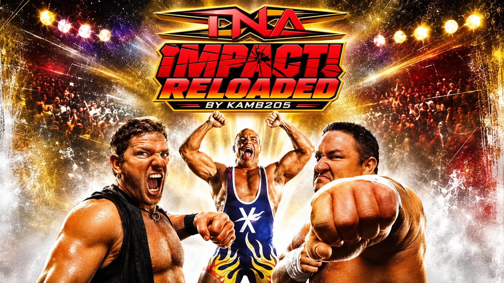
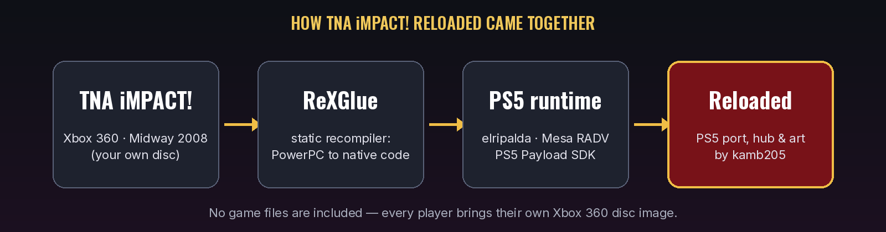

<p align="center">
  
</p>

<p align="center">
  <a href="../../releases/latest"></a>
  
  
  <a href="https://github.com/rexglue/rexglue-sdk"></a>
  <a href="LICENSE"></a>
  <a href="https://buymeacoffee.com/kamb205"></a>
</p>

<p align="center">
  <b>TNA iMPACT!</b> (Xbox 360, Midway 2008) running natively on a jailbroken PS5 — statically recompiled, not emulated.<br>
  Recompiled and ported by <a href="https://github.com/kamb205"><b>kamb205</b></a>.
</p>

<p align="center">
  <a href="../../releases/latest"><b>Download</b></a> ·
  <a href="#install">Install</a> ·
  <a href="#settings">Settings</a> ·
  <a href="#controls">Controls</a> ·
  <a href="#building-from-source">Build from source</a> ·
  <a href="#credits">Credits</a> ·
  <a href="https://buymeacoffee.com/kamb205">Support</a>
</p>

---

<p align="center">
  
</p>

> [!IMPORTANT]
> **No game files are included.** You need your own Xbox 360 disc image of TNA iMPACT! (an `.iso`, or the disc's extracted files). The game's data — models, textures, sound, movies — always comes from your disc.

## What it is

A PS5 homebrew app (title ID `PPSA94007`) that runs TNA iMPACT! as native code. The Xbox 360 game's PowerPC code is statically recompiled with the [ReXGlue SDK](https://github.com/rexglue/rexglue-sdk) and runs on elripalda's ReXGlue PS5 runtime, drawing through Vulkan on Mesa RADV — there is no emulator in the loop. Your disc image provides the game's data at run time.

## Features

- **60 fps** at **720p** or **1440p**, with **AMD FSR 1** upscaling to the PS5's 4K output and up to **16x** texture filtering
- **DualSense**: rumble with **Off / Light / Medium / Full** levels (you feel each one as you pick it), light-bar colours, Options = Start, touchpad = Back
- A **settings hub** before the game starts, made for the controller
- **Finds your disc image by itself** — the app folder, `/data` or a USB drive; the `.iso` is read in place, no extracting needed
- Its own PS5 tile, icon and background: **TNA iMPACT! Reloaded**
- Crash reports and logs saved next to the app for easy bug reports

## Install

You need a jailbroken PS5 that runs homebrew apps from `/data/homebrew/` (e.g. etaHEN with ShadowMount+ or another homebrew launcher).

1. Download **`PPSA94007.zip`** from [Releases](../../releases/latest) and unzip it on your PC or Mac.
2. Over FTP, copy the **`PPSA94007`** folder into **`/data/homebrew/`**.
3. Copy **your own** game to the PS5, any one of:
   - your `.iso` into `/data/homebrew/PPSA94007/` (or anywhere in `/data/`, or a USB drive), or
   - the disc's extracted files (leave out `$SystemUpdate`) into `/data/homebrew/PPSA94007/Assets/`, so you have `Assets/default.xex`.
4. Start **TNA iMPACT! Reloaded** from your homebrew launcher and press **START GAME**.

If the hub says your disc image wasn't found, copy it to one of the places above and press **Triangle** to search again. With several dumps, pick one under **Settings → Game files**.

## Settings

Saved as you change them (`/data/homebrew/PPSA94007/UserData/settings.toml`) and applied when the game starts.

| Setting | Values |
| --- | --- |
| Resolution | 720p (Original), 1080p, **1440p (Recommended)** |
| Frame Rate | 30 fps, **60 fps (Original)** |
| Upscaling | **FSR 1 (Recommended)**, CAS Sharpen, Bilinear (Original) |
| Anti-Aliasing | Off (Original), FXAA, 2x / 4x MSAA |
| Anisotropic Filter | Off, 2x, 4x, 8x, **16x** |
| FPS Counter | On, Off |
| Vibration | Off, **Light**, Medium, Full |
| Light Bar | TNA Gold, Red, Blue, White, System |
| Menu Music | Off – 100% |
| Game files | your disc image / game folder |

Your own menu music (MP3, WAV, FLAC or OGG) goes in `/data/homebrew/PPSA94007/hub/music/`.

## Controls

**Hub**

| Button | Action |
| --- | --- |
| L1 / R1 | previous / next page (Home, Settings, About) |
| D-pad | move; Left / Right changes a setting |
| Cross | Start Game (Home) / change a setting |
| Triangle | search for your game again |
| Circle | back to Home |
| Options | start the game from any page |
| R3 | next menu song |

**In game** the DualSense maps to the Xbox 360 pad: Cross = A, Circle = B, Square = X, Triangle = Y, L1/R1 = LB/RB, L2/R2 = LT/RT, Options = Start, touchpad = Back.

## Updating

Copy the new release's `PPSA94007` folder over the old one. Your game files, saves and settings (`UserData/`) are kept.

## Known issues

- Online play (Xbox LIVE) isn't available.
- Button prompts in the game's menus still show Xbox buttons.
- In Create-a-Player and Story mode the character is shown dark.
- The first time a scene loads it may stutter briefly while its shaders are built (cached after that).

## Reporting a problem

[Open an issue](../../issues) with the newest file from `/data/homebrew/PPSA94007/logs/` (and `UserData/crashes/` if there is one), what you were doing, and your firmware. Discord: `kamsb205`.

## Building from source

You need your own `default.xex`, the [ReXGlue SDK](https://github.com/rexglue/rexglue-sdk) (codegen) and its PS5 runtime branch (elripalda's `rexglue-ps5-svr2008`), the PS5 Payload SDK, and Nazky's ps5-plume-triangle (RADV link recipe, CRT, signer). The SDK changes this port needs are in [`patches/rexglue-ps5-all.patch`](patches/rexglue-ps5-all.patch): clone [elripalda/svr2011-ps5](https://github.com/elripalda/svr2011-ps5) branch `rexglue-ps5-svr2008`, check out `c09db52`, then `git apply patches/rexglue-ps5-all.patch`.

1. Put your own disc's `default.xex` in `private/extract/` (`tools/xdvdfs.py` reads it from your `.iso`) and run
   `rexglue codegen tnaimpact_manifest.toml`, then the post-codegen steps:
   ```sh
   python3 -I tools/prune_seeds.py
   python3 -I tools/fix_unresolved.py generated/default
   python3 -I ps5/tools/ps5_patch_generated.py ps5/generated/rexglue.cmake tnaimpact
   ```
2. Configure and build the PS5 app:
   ```sh
   cmake -S ps5 -B ps5/out/ps5 -G Ninja -DCMAKE_BUILD_TYPE=Release \
     -DCMAKE_TOOLCHAIN_FILE=ps5/cmake/ps5-toolchain.cmake \
     -DPS5_PAYLOAD_SDK=<ps5-payload-sdk> -DREXSDK_DIR=<rexglue PS5 runtime checkout> \
     -DREXGLUE_USE_VULKAN=ON
   cmake --build ps5/out/ps5 -j2
   ```
3. Art and package: `tools/make_release.sh` (runs `ps5/art/make_ps5_art.py`, `ps5/art/apply_custom_art.py` and `ps5/tools/ps5_package.sh`, then zips `dist/PPSA94007`).

A desktop (macOS) build of the same code is in the root `CMakeLists.txt` (`cmake --preset mac-arm64-release`).

## Credits

- **[kamb205](https://github.com/kamb205)** — the recompilation of TNA iMPACT!, the PS5 port and the Reloaded artwork. Discord `kamsb205` · [Buy me a coffee](https://buymeacoffee.com/kamb205)
- **Midway Studios Los Angeles** — TNA iMPACT! (2008). All names and marks belong to their owners.
- **[elripalda](https://github.com/elripalda)** — the ReXGlue PS5 runtime and the hub this port's is based on ([SvR2008-Recomp-PS5](https://github.com/elripalda/SvR2008-Recomp-PS5), GPL-3.0).
- **[ReXGlue](https://github.com/rexglue/rexglue-sdk)** — the static recompiler and runtime; **[Xenia](https://xenia.jp)** — the Xbox 360 emulator its code comes from.
- **PS5 tooling** — the PS5 Payload SDK; Nazky's ps5-plume-triangle / UnleashedRecomp-Prospero (also the DualSense vibration-mode approach) and mihawk-99's RADV link recipe; Mesa RADV.
- **Libraries** — AMD FidelityFX FSR 1 (MIT), Dear ImGui, stb, stb_vorbis, dr_mp3, dr_flac; Oswald and Inter fonts (SIL Open Font License).

## Support

If you enjoy the port, you can support it here: **[buymeacoffee.com/kamb205](https://buymeacoffee.com/kamb205)** ☕

## Disclaimer

This is an unofficial fan project, not affiliated with or endorsed by Midway, TNA / Total Nonstop Action Wrestling, Sony or Microsoft. No game data is distributed: you must own the game and use your own disc image. Released under the [GPL-3.0](LICENSE).
